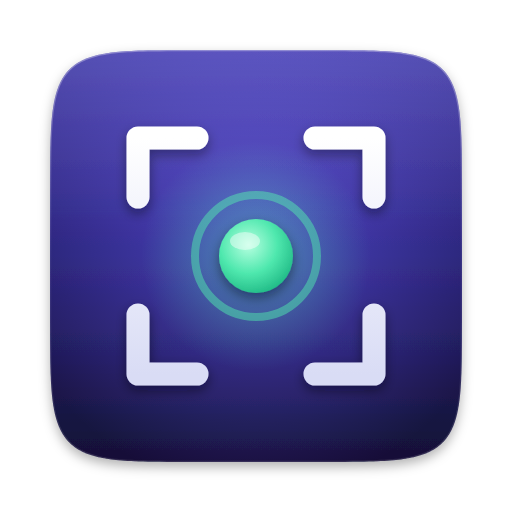

# ShowTake for Claude Code

Your coding agent films your app's demo video. This plugin adds the [ShowTake](https://showtake.app) MCP server
and a `film-app-demo` skill to Claude Code: Claude drives your real iOS app in a clean Simulator (or your Mac app
in its own window) while ShowTake records, then renders zooms on every tap, captions, App Store previews, App
Store screenshots and social cuts. Recordings never leave your Mac.

Requires the ShowTake Mac app (macOS 26 Tahoe or later, free tier available):

```
brew install --cask orchestero/tap/showtake
```

or download it from [showtake.app/download](https://showtake.app/download).

## Install the plugin

```
/plugin marketplace add orchestero/showtake-claude-plugin
/plugin install showtake@showtake
```

Without the plugin, one command adds the MCP server:

```
claude mcp add --scope user showtake -- "/Applications/ShowTake.app/Contents/MacOS/showtake-mcp"
```

## Use it

Ask: "Film a 20-second demo of adding a task in my app and export an App Store preview."

The skill makes Claude run `doctor` when something is off, plan 6-8 steps, record a take, retake until it is
clean, save it as a replayable flow and export the presets you asked for.

## What's inside

| Path | What |
| --- | --- |
| `.claude-plugin/marketplace.json` | Marketplace `showtake` |
| `plugins/showtake/.claude-plugin/plugin.json` | Plugin manifest |
| `plugins/showtake/.mcp.json` | Local stdio MCP server inside the app |
| `plugins/showtake/skills/film-app-demo/SKILL.md` | The filming workflow |

Docs: [MCP setup](https://showtake.app/docs/mcp-setup) · [Tools](https://showtake.app/docs/tools) ·
[Pricing](https://showtake.app/pricing). Bugs and requests:
[orchestero/showtake-issues](https://github.com/orchestero/showtake-issues).

## License

The files in this repository are MIT licensed (see [LICENSE](LICENSE)). The ShowTake app is proprietary software
with a free tier ([terms](https://showtake.app/terms)).
